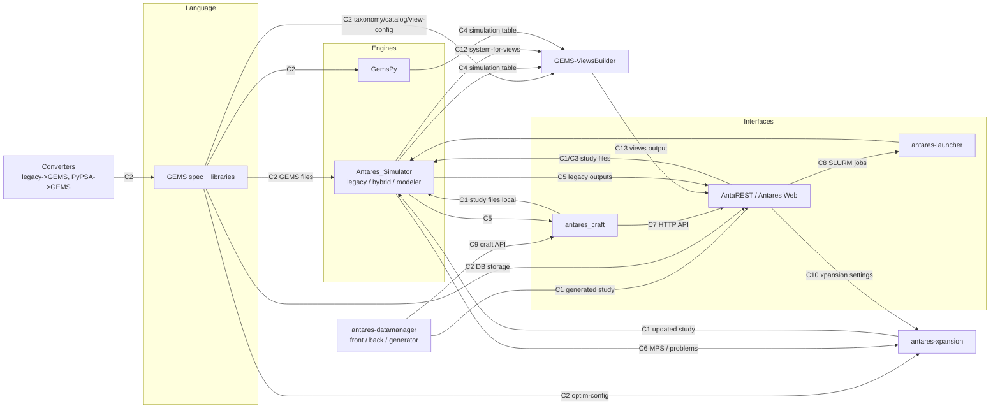

# Interactions and contracts (snapshot 2026-11-25)

A **contract** is anything one module produces and another consumes. Changing a contract means a coordinated change
across all its consumers. Identify contracts first when analysing impact. Pins and current version gaps are in
`versions.md`.

## Data-flow diagram

## Contract catalogue

| # | Contract | Owner (source of truth) | Producers | Consumers | Versioned by | Where specified |
|---|---|---|---|---|---|---|
| C1 | **Antares study format** (legacy: `input/`, `settings/`, `user/expansion/`, `study.antares` version) | Antares_Simulator | AntaREST, antares_craft, xpansion-study-updater, datamanager-generator (through craft) | Simulator, AntaREST, craft, launcher, Xpansion | Study version + migration guides (10.3 removes hydro leeway) | Simulator `docs/reference/solver/inputs.md`, `docs/reference/migration-guides.md`, `docs/developer-guide/8-study-format-conventions.md` |
| C2 | **GEMS files**: library, system, data-series, calendar, optim-config, scenario-builder, solver-optimization, taxonomy, catalog, view-config | GEMS | Modellers, converters, GemsPy (`gems_craft`), AntaREST (database + API); antares_craft: none | Simulator (hybrid, modeler), GemsPy, Xpansion gems workflow, ViewsBuilder, AntaREST | GEMS language version (`COMPATIBILITY.md`) + library versions | GEMS `doc/user-guide/input-files/` |
| C3 | **Hybrid study** = C1 + C2 in `input/` (`system.yml` marks it hybrid; `model-libraries/`, `data-series/`), with GEMS <-> legacy area connections | Simulator + GEMS jointly | Modellers, GemsPy `write_yaml_hybrid_library`, AntaREST (create and launch; UI surface to verify) | `antares-solver`, Xpansion with optim-config | C1 and C2 | GEMS `doc/interoperability/hybrid/*`, Simulator `docs/reference/solver/hybrid-studies.md` |
| C4 | **Simulation table** (block, component, output, absolute/block time index, scenario, value, basis_status) | GEMS (abstract definition) | Simulator: hybrid = one file per MC year and weekly-resolution stage (`optim-nb-1`, `optim-nb-2`, `peak-shaving`, `adq-patch`, chosen with `simulation-table-stages`); modeler = one per scenario; CSV or Parquet; in `simulation-tables/` from 10.3. GemsPy: `output/<run_id>/simulation_table/`, one file per scenario + `scenario-common` + `manifest.json`, Parquet by default | ViewsBuilder, analysts, e2e tests | GEMS language version (0-based `block` and time indices) | GEMS `doc/user-guide/outputs/simulation-table.md` (links to each interpreter's storage page); Simulator `docs/reference/modeler/03-outputs.md`, `docs/developer-guide/simulation-table-e2e-coverage.md` |
| C5 | **Legacy outputs** (mc-all / mc-ind, area and link variables, synthesis) | Simulator | Simulator | AntaREST results, craft output reading, Xpansion (operating costs), users' post-processing (antaresRead etc.) | Simulator version | Simulator `docs/reference/solver/outputs.md` |
| C6 | **Optimisation problem files** (MPS + variable/constraint naming, per week/year; year, week and day 0-based in file names from 10.3) | Simulator / GEMS (`optimization-problem-files.md`) | `antares-solver` with export, `antares-problem-generator` | Xpansion `lp_namer` (parses year and week from file names in `src/cpp/lpnamer/input_reader/MpsTxtWriter.cpp`: check it before bumping the Simulator pin), `benders`; debugging tools | Simulator version (Xpansion pin in `antares-version.json`) | GEMS `doc/user-guide/outputs/optimization-problem-files.md`, Xpansion docs |
| C7 | **Antares Web HTTP API** | AntaREST | AntaREST | antares_craft, datamanager-generator (through craft), other apps | AntaREST release | AntaREST OpenAPI |
| C8 | **Launch interface** (local binaries per version, SLURM via antares-launcher) | AntaREST + antares-launcher | AntaREST | antares-launcher -> cluster -> Simulator / Xpansion binaries | AntaREST config, launcher pin | AntaREST `docs/configuration.md`, launcher README |
| C9 | **Python APIs** (`antares_craft`, `gemspy` = `gems_craft` + `gems_runner`) | craft / GemsPy | - | User scripts, datamanager-generator (craft), ViewsBuilder and GEMS e2e tooling (gemspy), converters (gemspy) | PyPI semver (0.x: minors may break) | each repo's API reference |
| C10 | **Xpansion inputs** (`user/expansion/`: candidates.ini, settings.ini, constraints, sensitivity; or `input/optim-config.yml`) | Xpansion | Users, craft, AntaREST Xpansion view | Xpansion | Xpansion version | Xpansion `docs/reference/inputs/*` |
| C11 | **Datamanager study JSON + time-series files** (study definition and feather series on the NAS; `StudyData` model) | antares-datamanager | datamanager-back | datamanager-generator | datamanager version | `generator/models/study_data_json_model.py`, back DTOs (no public doc) |
| C12 | **`system-for-views.yml`** (components, connections, cluster names, area districts of a run) | Antares_Simulator | Simulator (solver, modeler); in `views/input/` of the output from 10.3, where legacy component ids also lose `_node` / `_link` and spaces become underscores (also visible in C4 and in converter view configs) | ViewsBuilder | Simulator version + library version (ViewsBuilder fails when file and library disagree on a model or property) | Simulator `src/view-builder/` |
| C13 | **Views output** (`<output>/views/input/view_config_*.yml`, `<output>/views/output/<view_id>--<pattern_id>--<timestamp>.parquet`) | GEMS (view-config, views output docs) + ViewsBuilder | Simulator (`views/input/`), ViewsBuilder (`views/output/`) | AntaREST output views (`antarest/output/filestudy/gems_views.py`) | ViewsBuilder version + GEMS language version | GEMS `doc/user-guide/outputs/views.md`, `doc/user-guide/input-files/view-config.md` |

## Impact heuristics (who to worry about)

- Touch **craft's object model / Web study-creation API / study version** -> `antares-datamanager-generator` (builds
  every generated study through craft): bump its `~=` pin, re-run generation tests. A change to the datamanager
  study JSON (C11) needs back and generator released together.
- Touch **GEMS syntax or semantics** -> both interpreters, Xpansion gems workflow, converters (output must stay
  valid), libraries (version bump + CHANGELOG + sha256), ViewsBuilder (if outputs or taxonomy are affected),
  AntaREST GEMS storage, e2e tests, docs.
- Touch **legacy study format** -> datamanager-generator (through craft), AntaREST (parsers, UI, variant commands,
  upgrade), antares_craft (models, local and API backends), Xpansion (reads/updates the study), launcher (version
  detection), migration guide, antares-doc, legacy -> GEMS converter.
- Touch **hybrid** -> C1 and C2 consumers; check legacy-area connections, Monte Carlo per-scenario optimisation, LP
  vs MILP, horizon and resolution, outputs (legacy + simulation table consistency), AntaREST hybrid launch.
- Touch **output layout** (folder names, file names, component ids) -> ViewsBuilder (C4, C12), AntaREST outputs and
  views (C5, C13), Xpansion (C6, costs), converter view configs (component ids), GEMS docs and e2e references,
  downstream R / Python readers.
- Touch **MPS / problem structure or naming** -> Xpansion `lp_namer` / `benders`, `antares-problem-generator`.
- Touch **Web API** -> antares_craft API backend and its tests against a server; datamanager-generator in API mode.
- Touch **GEMS storage in Web** -> AntaREST DB schema and migrations, craft (will need the same objects), GEMS file
  formats (import/export round trip must stay lossless), antares-doc tutorials.
- Touch **views** (taxonomy, catalog, view-config, views output naming) -> ViewsBuilder, AntaREST views reader
  (C13), converter catalogs and view configs, GEMS docs.
- Any **user-visible change** -> antares-doc (release-notes feed, tutorial or reference page, roadmap line) in
  addition to repo docs.
- New **user-facing capability** -> where should it live: engine (Simulator / GemsPy), language (GEMS), planning
  (Xpansion), interface (Web / craft) or post-processing (ViewsBuilder)? Decide explicitly; avoid implementing the
  same capability in two layers.
